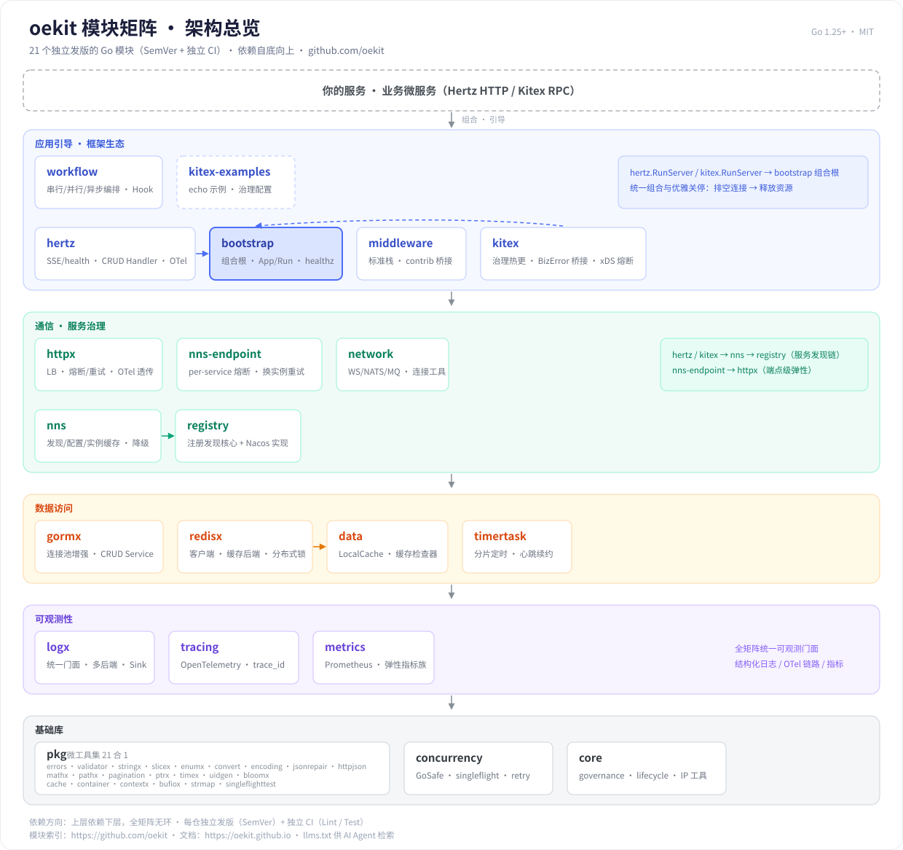

# oekit

> **O**pen **E**asy **Kit** — 开源 · 易用 · 工具集合

   

oekit 是一套按能力分层的独立 Go 模块矩阵：**24 个活跃模块仓库，每仓独立发版（SemVer）、独立 CI、按需取用**。
从 `errors` / `timex` 这类零依赖微包，到 Hertz / Kitex 生态适配器，全部遵循同一套接口分层与开发规范。

- 项目主页：**https://oekit.github.io/**
- 组织：https://github.com/orgs/oekit/repositories
- 协议：MIT

## 架构总览

依赖严格自底向上：**上层依赖下层，全矩阵无环**。

<p align="center">
  <picture>
    <source media="(prefers-color-scheme: dark)" srcset="docs/assets/architecture-dark.svg">
    
  </picture>
</p>

| 能力层 | 模块 |
|---|---|
| 应用引导 · 框架生态 | [bootstrap](https://github.com/oekit/bootstrap) · [hertz](https://github.com/oekit/hertz) · [kitex](https://github.com/oekit/kitex) · [middleware](https://github.com/oekit/middleware) · [workflow](https://github.com/oekit/workflow) · [kitex-examples](https://github.com/oekit/kitex-examples) · [k8s](https://github.com/oekit/k8s) |
| 通信 · 服务治理 | [httpx](https://github.com/oekit/httpx) · [nns-endpoint](https://github.com/oekit/nns-endpoint) · [network](https://github.com/oekit/network) · [nns](https://github.com/oekit/nns) · [registry](https://github.com/oekit/registry) |
| 数据访问 | [gormx](https://github.com/oekit/gormx) · [redisx](https://github.com/oekit/redisx) · [etcdx](https://github.com/oekit/etcdx) · [data](https://github.com/oekit/data) · [timertask](https://github.com/oekit/timertask) |
| 可观测性 | [logx](https://github.com/oekit/logx) · [tracing](https://github.com/oekit/tracing) · [metrics](https://github.com/oekit/metrics) |
| 基础库 | [pkg](https://github.com/oekit/pkg)（23 合 1）· [concurrency](https://github.com/oekit/concurrency) · [core](https://github.com/oekit/core) · [kitx](https://github.com/oekit/kitx)（标识与校验）|

几条关键依赖链：

- **服务发现**：`hertz` / `kitex` → `nns` → `registry`（Nacos 实现 + 降级链）
- **就绪门与延迟注册**：`hertz.RunServer` / `kitex.RunServer`（`WithOnReady` TCP 探活）→ `bootstrap.App.Ready()` → NNS 才注册（`bootstrap/nacos` v0.3.0 起）
- **端点弹性**：`nns-endpoint` → `httpx`（per-service 熔断 + 换实例重试）；熔断语义统一由 `concurrency/breaker` 三态状态机（closed/open/half-open + 代绑定）供给
- **中间件一份逻辑两端跑**：`core/chain` + `core/transport` → `middleware/chainmw` → hertz 直用、kitex 经 `kitex/chainmw.ToKitex` 桥接
- **数据访问**：`hertz/crudh` → `gormx`（泛型 CRUD Handler / 事务防丢更新）；`redisx` → `data`（缓存接口实现）
- **弹性原语**：`concurrency`（滑动窗口 / 三态自适应熔断 `ErrCircuitOpen` / CPU 自适应降载）；`redisx` 内置 ratelimit（Redis 分布式限流，故障本地兜底）
- **优雅关停**：`hertz.RunServer` / `kitex.RunServer` → `bootstrap` 组合根（就绪门 → 排空连接 → 释放资源；Manager 正身 `core/lifecycle`）

> 完整「模块 × 依赖」表见各仓 README 的「矩阵总览」（由 [matrix-tools](https://github.com/oekit/matrix-tools) 自动生成与每周巡检）。

## 名字由来

| 字母 | 含义 |
|---|---|
| **o** | **Open** — 开源：MIT 协议，全部公开 |
| **e** | **Easy** — 易用：一个 import 即用，微库零捆绑 |
| **kit** | **Kit** — 工具集合：微库 → 门面 → 框架生态，同一套规范 |

## 快速开始

```bash
# 微工具集
go get github.com/oekit/pkg@latest

# HTTP 服务全家
go get github.com/oekit/middleware github.com/oekit/hertz

# 日志门面 + Redis 全家桶
go get github.com/oekit/logx github.com/oekit/redisx

# 或：一次拉齐一组经矩阵 CI 验证的兼容版本（BOM 快照，本仓即该模块）
go get github.com/oekit/oekit@latest
```

> **Go 版本**：本仓（BOM 快照）要求 **Go ≥ 1.26.0**——`go get github.com/oekit/oekit@latest`
> 会把下游 go.mod 的 `go` 指令抬到 1.26.0（实测：`go: upgraded go 1.24 => 1.26.0`）。
> 只按需取单个模块则不受此限：轻量模块（pkg / logx / core / concurrency / registry /
> timertask / workflow 等）要求 Go ≥ 1.24，框架生态那几个
> （hertz / kitex / httpx / middleware / tracing / k8s / etcdx / network / nns-endpoint）
> 要求 Go ≥ 1.26——**各仓的 `go.mod` 是唯一权威**，本 badge 只描述伞仓自身。

## 兼容矩阵快照（BOM 模块）

各模块独立 SemVer，数字本身不带兼容信息——**「这些模块当前互相兼容」**由本仓声明：
`matrix.go` 记录全部模块（含 `logx/hlog` 等嵌套模块）的版本快照（`Matrix` / `Versions` /
`VersionOf`），`go.mod` 以 require 地板钉住同一组版本。`go get github.com/oekit/oekit@latest`
会把下游已用的 oekit 模块统一抬到快照口径（MVS 地板），不会静默落到互不兼容的旧组合；
不需要整组对齐就按需 `go get` 各模块，本包零强制。

- 快照由 `matrix-tools/scripts/gen_matrix_go.py` 从各仓**远端 tag** 生成，口径与
  [versions.json](https://oekit.github.io/versions.json) 同源；矩阵版本变化后重跑生成并打新 tag（audit 有新鲜度门禁）
- 每个模块的 GitHub Release（notes = 同版本 CHANGELOG 小节 + 该 tag go.mod 的矩阵依赖地板）
  见各仓 Releases 页；`releases/latest` 全矩阵可解析
- 本仓 go.mod 的 require 是无 import 的地板，**勿在此仓跑 `go mod tidy`**（会清掉；误跑后重跑生成器即恢复）

## AI Agent 入口

- 每个模块仓根目录均含 `AGENTS.md`（硬规则速览 + 本仓包清单）
- 机器可读全矩阵索引：https://oekit.github.io/llms.txt
- 《AI Agent 使用》指南：https://oekit.github.io/guide/ai-agent.html

## 兼容性

| 旧路径（重定向仍可用） | 新路径 |
|---|---|
| `git.enjoye.top/enjoydream/ekit/…`（ekit 单体，冻结维护） | `github.com/oekit/…` |
| `github.com/yi-nology/ekit-…` | `github.com/oekit/…` |
| `github.com/oekit/redis` | `github.com/oekit/redisx`（v0.5.0 起） |
| `github.com/oekit/gorm` | `github.com/oekit/gormx`（v0.3.0 起） |
| `github.com/oekit/istio` | `github.com/oekit/kitex/istio`（v0.5.0 起，微库已收编） |
| `github.com/oekit/handler/xxx` | `github.com/oekit/hertz/xxx`（v0.5.0 起，微库已收编） |
| `github.com/oekit/<旧微库>`（stringx/slicex/validator 等已删仓） | `github.com/oekit/pkg/xxx`（微库并入 pkg；uidgen/validator 又于 pkg v0.10.0 拆至 oekit/kitx） |
| `github.com/oekit/pkg/collectionx` | `github.com/oekit/pkg/container`（pkg v0.9.0 收编） |
| `github.com/oekit/logx/shutdown` | `github.com/oekit/core/lifecycle`（别名已弃用） |
| `<mod>/<mod>` 双层路径（registry/nns/workflow/kitex/middleware/hertz） | `github.com/oekit/<mod>`（模块根，2026-10-17 收平） |

## License

MIT — 见 [LICENSE](LICENSE)
